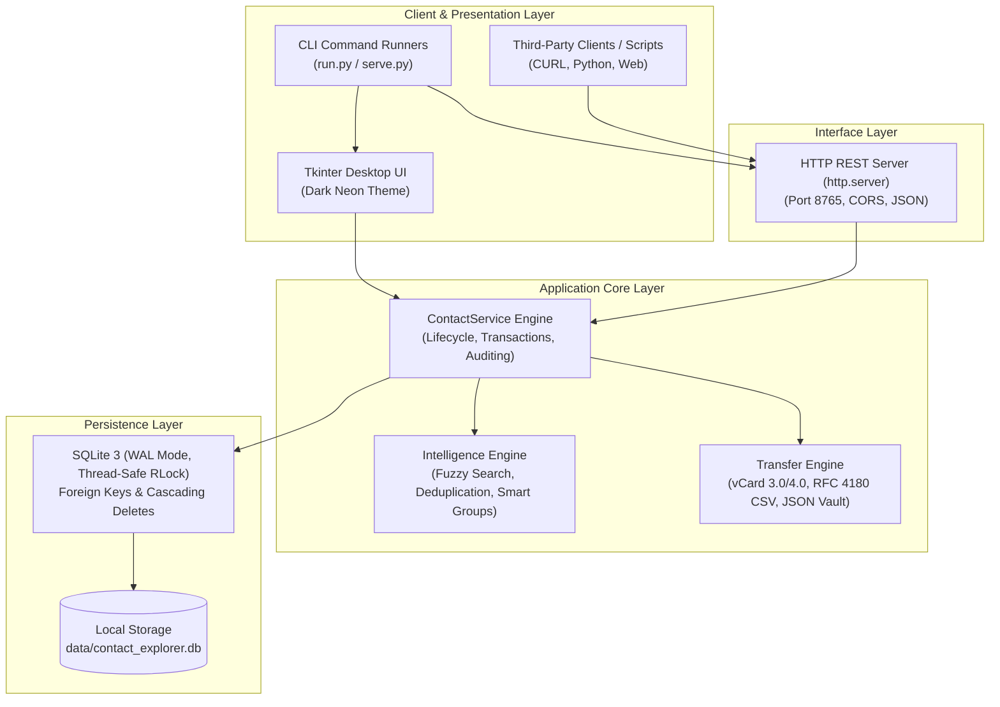

<div align="center">

# Contact Explorer — Python Edition

### **A CTYV PRODUCT**
*Enterprise-Grade, Offline-First Contact Management & Intelligence Engine*

[](https://github.com/C-T-Y-V)
[](https://www.python.org/)
[](LICENSE)
[](.github/workflows/ci.yml)
[](.github/workflows/codeql.yml)
[](https://github.com/astral-sh/ruff)
[](https://mypy-lang.org/)
[](#architecture)

<p align="center">
  <b>Contact Explorer</b> is an offline, privacy-first desktop contact management system and headless micro-service. Designed with zero third-party dependencies, ACID-compliant local SQLite storage, tokenized multi-field fuzzy search, heuristic deduplication, and lossless import/export across vCard, CSV, and encrypted JSON vaults.
</p>

[Quick Start](#-quick-start) •
[Architecture](#-architecture) •
[Features](#-core-capabilities) •
[REST API](#-headless-rest-api) •
[Documentation](#-documentation) •
[Contributing](#-contributing)

</div>

---

## 🏛 Architecture

Contact Explorer follows a modular, decoupled architecture adhering to strict domain boundaries. Business logic is completely separated from persistence, external formats, and visual presentation.



---

## ⚡ Core Capabilities

- **Zero-Trust Local Privacy:** 100% offline. Zero telemetry, zero analytics tracking, and zero outbound network connections.
- **Pure Standard Library Engineering:** Built exclusively on Python's built-in standard library (`sqlite3`, `tkinter`, `dataclasses`, `http.server`, `json`, `csv`). No `pip install` required for production use.
- **Enterprise SQLite Persistence:** Configured with Write-Ahead Logging (`PRAGMA journal_mode = WAL`), full relational integrity (`PRAGMA foreign_keys = ON`), and reentrant thread mutexes (`RLock`).
- **Deep Contact Data Model:** Normalized multi-phone and multi-email support with custom labels, organizational hierarchies, arbitrary tags, favorites, and interaction counters.
- **Tokenized & Fuzzy Query Engine:** Instant search across all attributes supporting field operators:
  - `company:acme` — Filters by organization
  - `group:family` — Filters by hierarchical group
  - `tag:vip` — Filters by assigned tags
  - `city:jaipur` — Matches geographic locations
  - `is:favorite` — Matches starred contacts
- **Heuristic Duplicate Detection & Merging:** Identifies duplicate identities via exact phone numbers, normalized 10-digit suffixes, case-folded emails, and edit-distance name matching.
- **30-Day Soft-Delete Recycle Bin:** Deleted records are archived with a full JSON state snapshot, allowing instant, loss-free restoration or permanent compliance purging.
- **Lossless Interchange Suite:** Full round-trip support for **vCard (VCF 3.0/4.0)**, **CSV (RFC 4180)**, and complete relational **JSON Vaults**.

---

## 🚀 Quick Start

### 1. Prerequisites
- Python 3.10, 3.11, 3.12, or 3.13.
- Tkinter (included with standard Windows and macOS Python installers).

### 2. Clone Repository
```bash
git clone https://github.com/priyanshu-ctyv/contact-explorer-py.git
cd contact-explorer-py
```

### 3. Launch Desktop UI
Run directly without installing any packages:
```bash
# Windows
python run.py
# or using batch script
run.bat
# or using PowerShell
.\run.ps1
```

By default, data is stored at `data/contact_explorer.db`. To specify a custom database location:
```bash
python run.py --db "C:\path\to\custom_contacts.db"
```

---

## 🌐 Headless REST API

Contact Explorer includes a built-in, lightweight HTTP REST server for local automations and third-party integrations.

### Launch Server
```bash
python serve.py --host 127.0.0.1 --port 8765
# or
serve.bat
```

### Key Endpoints
| Method | Endpoint | Description |
| :--- | :--- | :--- |
| `GET` | `/api/health` | Server health check and version status |
| `GET` | `/api/stats` | Aggregated database metrics (contacts, trash, favorites) |
| `GET` | `/api/contacts` | List contacts with optional `?search=<query>` parameter |
| `GET` | `/api/contacts/{id}` | Retrieve individual contact details |
| `POST`| `/api/contacts` | Create a new contact from JSON payload |
| `DELETE` | `/api/contacts/{id}` | Soft-delete contact to 30-day recycle bin |
| `GET` | `/api/groups` | List all contact folders and group hierarchies |
| `GET` | `/api/tags` | List all registered tags and usage counts |
| `GET` | `/api/trash` | View soft-deleted contact snapshots |
| `POST`| `/api/trash/restore` | Restore contact from recycle bin |
| `GET` | `/api/duplicates` | Retrieve clustered duplicate candidate groups |
| `GET` | `/api/vault` | Lossless export of complete database snapshot |

*For complete API schemas and curl examples, see [docs/API_REFERENCE.md](docs/API_REFERENCE.md).*

---

## 🧪 Developer & Quality Suite

We maintain enterprise code quality standards using modern Python tooling.

### Install Development Dependencies
```bash
pip install -e ".[dev]"
```

### Execute Test Suite
Contact Explorer includes unit, integration, and regression tests with high branch coverage:
```bash
pytest -v
```

### Linting & Type Checking
```bash
# Run Ruff linting
ruff check .

# Check code formatting
ruff format --check .

# Static type analysis
mypy contact_explorer
```

### Developer Scripts
```bash
# Populate database with realistic demo contacts & duplicate clusters
python scripts/seed_demo_data.py

# Benchmark bulk insert throughput (ops/sec) and search latency
python scripts/benchmark.py --count 1000
```

---

## 📁 Repository Structure

```text
contact-explorer-py/
├── .github/                   # GitHub Actions CI/CD workflows and issue templates
│   ├── ISSUE_TEMPLATE/        # Standardized Bug Report and Feature Request forms
│   └── workflows/             # Multi-OS CI matrix, CodeQL SAST, automated releases
├── contact_explorer/          # Core production package
│   ├── __init__.py            # Package exports and version metadata
│   ├── __main__.py            # CLI entrypoint (python -m contact_explorer)
│   ├── api.py                 # Threaded HTTP REST API implementation
│   ├── database.py            # SQLite engine, connection pooling, WAL mode
│   ├── intelligence.py        # Tokenized parser, fuzzy search, deduplication
│   ├── models.py              # Domain entities and dataclasses
│   ├── py.typed               # PEP 561 static typing marker
│   ├── service.py             # Business logic, transactions, audit logs
│   ├── transfer.py            # vCard, CSV, and Vault import/export routines
│   └── ui.py                  # Tkinter dark neon desktop interface
├── docs/                      # Architectural and engineering specifications
│   ├── ARCHITECTURE.md        # Comprehensive system design specification
│   ├── API_REFERENCE.md       # Complete HTTP REST API reference
│   ├── DATA_MODEL.md          # SQLite schema, ERD, and index strategies
│   └── IMPORT_EXPORT_SPEC.md  # vCard, CSV, and Vault file specifications
├── scripts/                   # Developer automation and benchmark scripts
│   ├── benchmark.py           # Bulk insert and latency benchmarking
│   └── seed_demo_data.py      # Demo data seeder
├── tests/                     # Automated test suite
│   ├── conftest.py            # Shared Pytest fixtures and mocks
│   ├── test_core.py           # Legacy core regression test suite
│   ├── unit/                  # Isolated component unit tests
│   └── integration/           # Live HTTP server integration tests
├── .editorconfig              # Uniform IDE indentation and formatting standard
├── .gitattributes             # Cross-platform line ending normalization
├── .gitignore                 # Enterprise-grade Git ignore patterns
├── CHANGELOG.md               # Version history adhering to Keep a Changelog
├── CODE_OF_CONDUCT.md         # Contributor Covenant v2.1 standard
├── CONTRIBUTING.md            # Contributor guidelines and branching workflows
├── LICENSE                    # MIT Open Source License
├── Makefile                   # Cross-platform task runner
├── pyproject.toml             # PEP 517/518/621 build configuration
├── requirements.txt           # Base requirements (Standard Library)
└── requirements-dev.txt       # Development and test tooling
```

---

## 📱 Mobile Companion (Android)

For users seeking mobile access, a companion native Android APK is located in `dist/ContactExplorer-Android.apk` with installation instructions in `dist/INSTALL.txt`. It delivers the same offline-first contact exploration capabilities built specifically for Android (API 26+).

---

## 🔒 Security & Privacy Posture

Contact Explorer is architected on a zero-trust offline model. We commit to:
1. Never initiating outbound connections.
2. Storing all personal data unencrypted only within user-specified local SQLite files.
3. Preventing file path traversals during data import/export routines.

To report security concerns, please consult our [Security Policy](SECURITY.md).

---

## 📄 License & Attribution

Distributed under the **MIT License (with Attribution)**. See [`LICENSE`](LICENSE) for complete details.

Copyright © 2026 **Priyanshu Sharma (CTYV) — A CTYV Product**. All rights reserved.

> **Attribution Note:** Derivative works, forks, and redistributions utilizing this software are requested and required to retain credit stating: *"A CTYV Product"* or *"Inspired by A CTYV Product"*.
