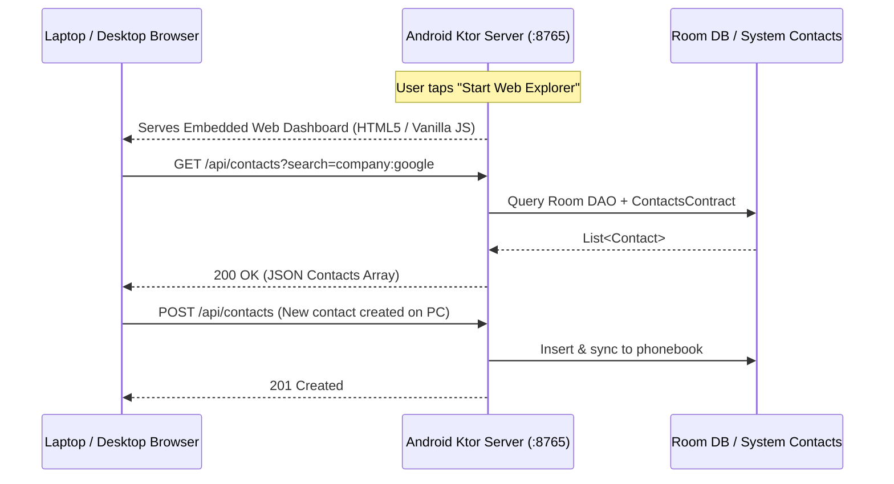
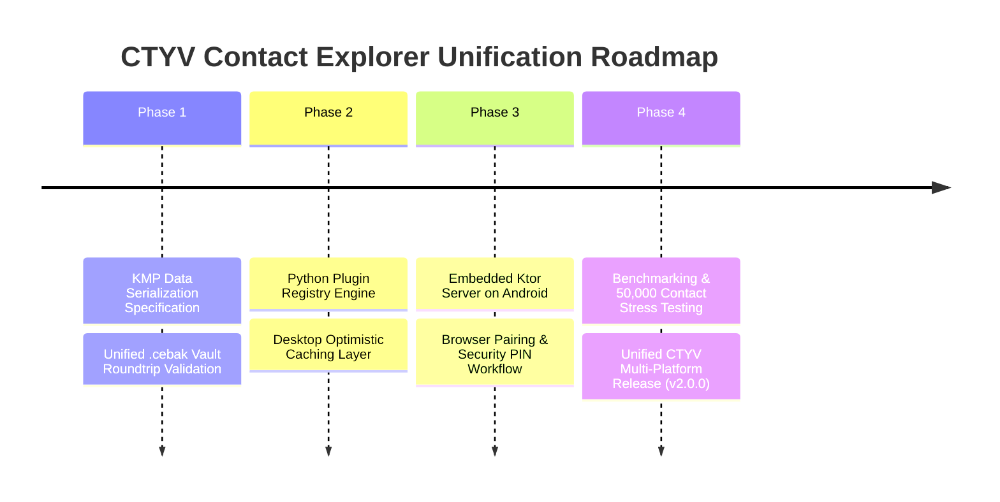

# Contact Explorer — Architectural Advancement & Unification Roadmap
### *A CTYV Engineering Specification*

---

## 🎯 Executive Overview

This specification establishes the technical roadmap for converging **Contact Explorer Python** (Desktop/Backend) and **Contact Explorer Kotlin** (Android Mobile) into a unified, privacy-first, zero-cloud contact intelligence ecosystem.

```mermaid
flowchart LR
    subgraph Mobile ["Contact Explorer Android (Kotlin)"]
        Ktor["Embedded Ktor HTTP Server\n(Port 8765 / Foreground Service)"]
        Room["Room Database Engine"]
        KMP["Universal KMP Serializer\n(vCard / CSV / .cebak)"]
    end

    subgraph Desktop ["Contact Explorer Desktop (Python)"]
        Browser["Desktop Web Browser\n(http://<phone-ip>:8765)"]
        PyUI["Tkinter Desktop App"]
        PyCore["Python Transfer Engine"]
    end

    Ktor <-->|Local Wi-Fi REST API (Zero Internet)| Browser
    KMP <--->|100% Lossless Vault Interchange| PyCore
    PyUI -.->|Direct Sync Mode| Ktor
```

---

## 🚀 Pillar 1: Embedded Ktor Server for Android (Local Wi-Fi Sync & Web Dashboard)

### 1.1 The Problem
Users currently have only two ways to move or edit phone contacts from a PC:
1. Surrendering contacts to cloud monopolies (Google Contacts, iCloud), destroying offline privacy.
2. Clunky USB cables and manual file export/import workflows.

### 1.2 The Solution: Headless Embedded Ktor Server
Running an embedded, lightweight Ktor HTTP server directly inside the Android app when phone and PC are connected to the same local Wi-Fi network.



### 1.3 Key Architectural Features
1. **Zero Internet Permissions Required:**
   - Uses `android.permission.ACCESS_WIFI_STATE` and local socket binding (`0.0.0.0:8765`).
   - Operates with zero internet access permission (`android.permission.INTERNET` not required for purely local subnet sockets).
2. **Foreground Service Lifecycle:**
   - Runs as a manageable Android foreground notification (*"Contact Explorer Web Sync active on http://192.168.1.5:8765"*).
   - Auto-stops after 15 minutes of inactivity to preserve battery.
3. **Local Pairing & Security PIN (mTLS / One-Time Token):**
   - Displays a dynamic 6-digit PIN or QR code on the phone screen.
   - Any browser request must provide `Authorization: Bearer <PIN>` to prevent unauthorized devices on public Wi-Fi from reading contacts.
4. **Embedded Micro-Web Dashboard:**
   - Serves a lightweight (<150 KB gzip), single-page web app straight from Android assets.
   - Allows users to search, edit, tag, merge, and export phone contacts directly on their PC screen.

---

## 🔄 Pillar 2: Universal Data Interchange & KMP Serialization

### 2.1 The Problem
Schema drift between Python SQLite and Android Room SQLite can lead to data loss during cross-platform imports/exports (e.g. missing multiple phone labels, custom tags, or audit timestamps).

### 2.2 The Solution: Standardized Vault Specification (`.cebak` / `vault.json`)
Extracting contact serialization into a standardized schema specification shared across both Python and Kotlin:

```json
{
  "$schema": "https://raw.githubusercontent.com/C-T-Y-V/contact-explorer-py/main/docs/schemas/vault-v1.json",
  "version": "1.0.0",
  "generator": "CTYV Contact Explorer",
  "exported_at": 1715000000000,
  "contacts": [
    {
      "id": "c7a1c320-b384-48f8-b397-bb19cbdf5208",
      "name": "Jane Doe",
      "company": "Acme Corp",
      "address": "123 Market St",
      "note": "Lead Architect",
      "is_favorite": true,
      "phones": [
        { "number": "+1 555 123 4567", "label": "Mobile" },
        { "number": "+1 555 987 6543", "label": "Work" }
      ],
      "emails": [
        { "email": "jane@example.com", "label": "Work" }
      ],
      "groups": ["Engineering", "Architecture"],
      "tags": ["vip", "lead"],
      "times_contacted": 14,
      "created_at": 1715000000000,
      "updated_at": 1715000000000
    }
  ],
  "groups": [
    {
      "id": "grp-eng",
      "name": "Engineering",
      "parent_id": null
    }
  ],
  "tags": [
    { "id": "tag-vip", "name": "vip" }
  ],
  "smart_rules": [
    { "id": "sr-1", "name": "Acme Staff", "field": "company", "value": "Acme" }
  ]
}
```

### 2.3 Kotlin Multiplatform (KMP) Module
- Implement a pure Kotlin `core:serialization` module compiling to:
  - **JVM / Android**
  - **Native / Desktop**
- Guarantees 100% roundtrip fidelity for **vCard 3.0/4.0 (RFC 6350)**, **CSV (RFC 4180)**, and `.cebak` JSON vaults.

---

## 🧩 Pillar 3: Python Plugin Registry (Inspired by Android)

### 3.1 Porting Kotlin's Plugin Architecture to Python
Kotlin's `:core:plugin-api` and `:core:plugin-registry` model will be adapted for Python:

```python
# contact_explorer/plugins/base.py
from dataclasses import dataclass
from typing import Callable, Any

@dataclass
class PluginDescriptor:
    id: str
    name: str
    description: str
    category: str

class ExplorerPlugin:
    descriptor: PluginDescriptor
    
    def on_contact_saved(self, contact: Any) -> None: ...
    def on_search_query(self, query: str) -> list[Any]: ...
    def contribute_export_format(self) -> dict[str, Any]: ...
```

### 3.2 Target Extension Capabilities:
- **Custom Search Providers:** Integrate local LLM embeddings or phonetic algorithms.
- **Third-Party Sync Adapters:** Optional Nextcloud / CardDAV local adapters.
- **Custom Visual Themes:** Community themes for the Tkinter desktop GUI.

---

## ⚡ Pillar 4: Benchmarking & Automated Data Seeding Suite

### 4.1 Automated Seeding (`scripts/seed_demo_data.py` & Kotlin Benchmark Module)
- Generate scalable synthetic datasets (100, 1,000, 10,000, and 50,000 contacts).
- Include realistic Indian and global names, localized phone numbers, multi-email topologies, and controlled duplicate clusters (exact matches, partial name collisions, phone suffix overlaps).

### 4.2 Standard Performance Metrics Table
| Metric | Target (Desktop / Python) | Target (Mobile / Android) |
| :--- | :--- | :--- |
| **Bulk Insert Throughput** | > 500 records / second | > 250 records / second |
| **Search Query Latency (10k items)** | < 15 ms | < 8 ms (Room SQLite Index) |
| **Duplicate Clustering (10k items)** | < 250 ms | < 180 ms |
| **UI Interaction Latency** | < 16 ms (60 FPS) | 0 ms (Optimistic State) |
| **Binary / Memory Footprint** | < 30 MB RAM | < 4.5 MB APK / < 40 MB RAM |

---

## 📅 Phased Execution Schedule



---
*Maintained under the authority of **Priyanshu Sharma (CTYV)**.*
