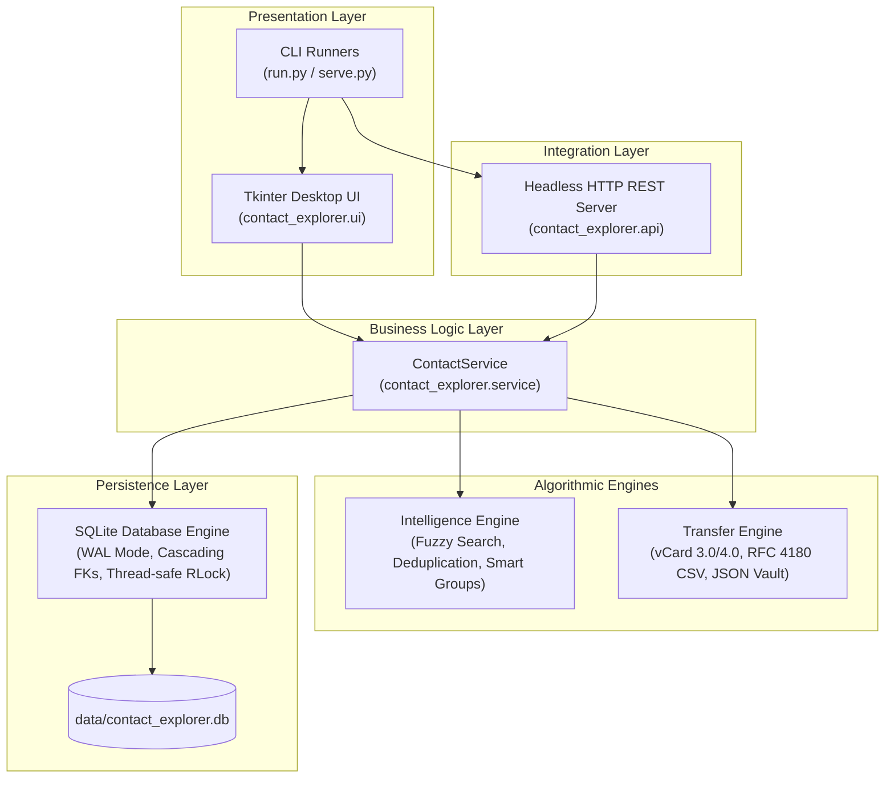
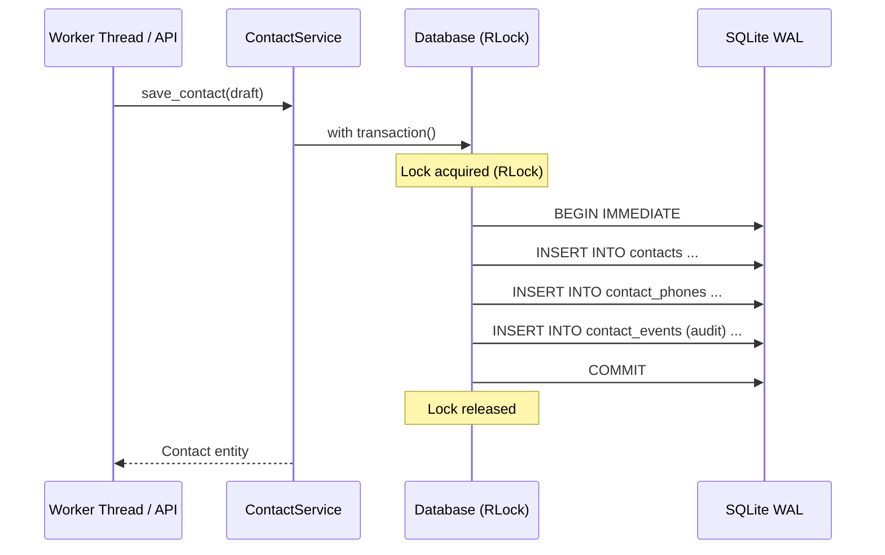

# Contact Explorer Architecture Specification

## 1. System Overview

Contact Explorer is designed as a modular, offline-first desktop application and headless micro-service. Its core architectural goal is to deliver responsive personal information management without cloud dependencies, telemetric tracking, or external binary dependencies.

---

## 2. Layered Component Boundaries

### 2.1 Presentation Layer (`contact_explorer.ui`)
- **Toolkit:** Standard library Python `tkinter` with themed ttk components.
- **Visual Design:** Dark neon palette, high contrast, responsive list/card layouts.
- **Isolation:** The UI acts purely as a consumer of `ContactService`. No SQL queries or file parsing occurs inside UI widgets.

### 2.2 Integration Layer (`contact_explorer.api`)
- **Server:** Built on `http.server.ThreadingHTTPServer`.
- **Protocol:** RESTful JSON over HTTP/1.1 with explicit CORS headers.
- **Portability:** Can run headlessly inside local automation scripts, browser extensions, or command-line wrappers.

### 2.3 Service Layer (`contact_explorer.service`)
- **Responsibility:** Orchestrates transactions, domain model invariants, audit logs, and coordinates storage with deduplication.
- **Lifecycle Management:** Handles full CRUD operations, favorites, recents, 30-day soft-delete trash bin, and snapshot restores.

### 2.4 Algorithmic Intelligence (`contact_explorer.intelligence`)
- **Tokenized Search:** Parses compound multi-field queries (e.g. `company:acme tag:vip rahul`) into token filters and free-text queries.
- **Fuzzy Search:** Normalizes inputs and scores string similarity using Levenshtein/Jaro-Winkler inspired character overlap scoring.
- **Deduplication:** Groups contacts by exact phone/email matches, normalized phone suffixes (last 10 digits), and high name-similarity thresholds.
- **Smart Groups:** Dynamic rule evaluator that matches contacts on arbitrary predicate expressions in real-time.

### 2.5 Transfer Engine (`contact_explorer.transfer`)
- **vCard Support:** Compliant parsing and generation for vCard 3.0 and 4.0 specifications, including multi-phone labels, emails, and address serialization.
- **CSV Support:** Standard RFC 4180 compliant CSV export/import with field escaping.
- **Vault Export:** Full lossless JSON snapshot of all contacts, folders, tags, events, and smart groups with relational integrity preserved.

### 2.6 Persistence Layer (`contact_explorer.database`)
- **Engine:** `sqlite3` configured with:
  - `PRAGMA foreign_keys = ON`: Strict relational integrity.
  - `PRAGMA journal_mode = WAL`: High-concurrency Write-Ahead Logging.
  - `PRAGMA busy_timeout = 15000`: Graceful lock wait under parallel threads.
- **Thread Safety:** All writes and transactions pass through a reentrant mutex (`threading.RLock`).

---

## 3. Concurrency & Transaction Model

Contact Explorer ensures ACID guarantees across concurrent threads (e.g., UI rendering while background import or HTTP API requests run):

---

## 4. Security & Privacy Guarantees

1. **Zero External Network Egress:** The application never initiates outbound internet connections.
2. **Loopback Confinement:** The HTTP API listens only on `127.0.0.1` by default.
3. **Data Sovereignty:** All data lives in user-controlled local files.
4. **Sandboxed Memory Footprint:** Minimal memory footprint (<30 MB baseline resident set size).
