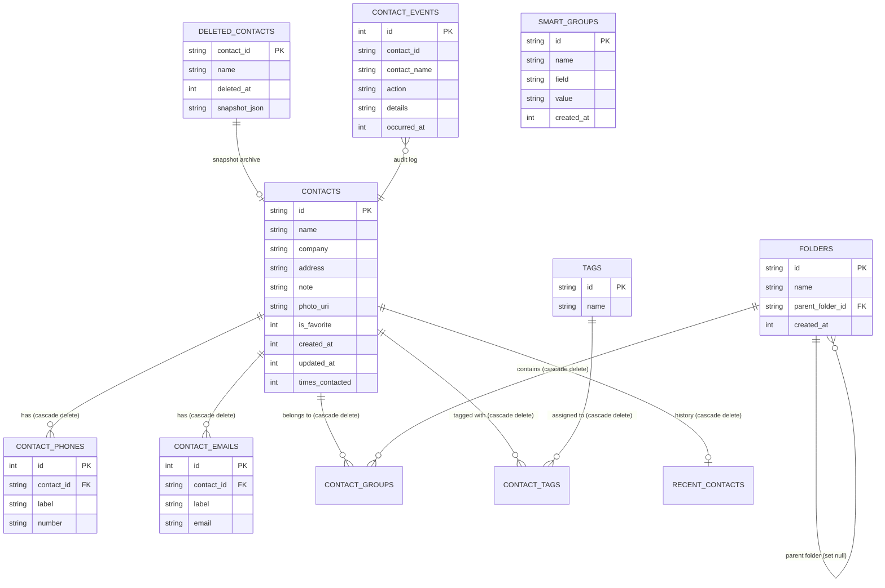

# Contact Explorer Data Model & Schema Specification

This document details the SQLite relational schema, index designs, cascading deletion rules, and domain models used by Contact Explorer.

---

## 1. Entity-Relationship Diagram (ERD)

---

## 2. Table Specifications & Indexes

### 2.1 `contacts`
The primary table storing core contact identities.
- `id` (TEXT PRIMARY KEY): UUID string identifier.
- `name` (TEXT NOT NULL): Display name.
- `company` (TEXT NOT NULL DEFAULT ''): Organization or business affiliation.
- `address` (TEXT NOT NULL DEFAULT ''): Physical street address.
- `note` (TEXT NOT NULL DEFAULT ''): Free-form notes.
- `photo_uri` (TEXT): Local file URI to contact photo.
- `is_favorite` (INTEGER NOT NULL DEFAULT 0): Boolean flag (0 or 1).
- `created_at` (INTEGER NOT NULL): Epoch millisecond timestamp.
- `updated_at` (INTEGER NOT NULL): Epoch millisecond timestamp.
- `times_contacted` (INTEGER NOT NULL DEFAULT 0): Interaction count.

**Indexes:**
- `idx_contacts_name`: `ON contacts(name COLLATE NOCASE)` for fast alphabetic sorting and case-insensitive searches.

### 2.2 `contact_phones`
Normalized table allowing arbitrary phone numbers per contact with customizable labels.
- `id` (INTEGER PRIMARY KEY AUTOINCREMENT)
- `contact_id` (TEXT NOT NULL REFERENCES contacts(id) ON DELETE CASCADE)
- `label` (TEXT NOT NULL DEFAULT 'Mobile')
- `number` (TEXT NOT NULL)

**Indexes:**
- `idx_phones_contact`: `ON contact_phones(contact_id)`
- `idx_phones_number`: `ON contact_phones(number)` for lightning-fast duplicate lookup.

### 2.3 `contact_emails`
- `id` (INTEGER PRIMARY KEY AUTOINCREMENT)
- `contact_id` (TEXT NOT NULL REFERENCES contacts(id) ON DELETE CASCADE)
- `label` (TEXT NOT NULL DEFAULT 'Home')
- `email` (TEXT NOT NULL)

**Indexes:**
- `idx_emails_contact`: `ON contact_emails(contact_id)`

### 2.4 `folders` (Groups) & `contact_groups`
Supports hierarchical groups (folders) with nested subfolders.
- `folders.parent_folder_id`: Self-referencing foreign key with `ON DELETE SET NULL`.
- `contact_groups`: Many-to-many junction table between contacts and groups.

### 2.5 `tags` & `contact_tags`
Arbitrary categorization labels with case-insensitive uniqueness.

### 2.6 `deleted_contacts` (Recycle Bin)
Implements a 30-day soft-delete mechanism.
- `contact_id` (TEXT PRIMARY KEY)
- `name` (TEXT NOT NULL)
- `deleted_at` (INTEGER NOT NULL)
- `snapshot_json` (TEXT NOT NULL): Complete serialized JSON of the contact, phones, emails, groups, and tags at the exact deletion instant. Enables 100% loss-free rollback.

### 2.7 `contact_events` (Audit Trail)
Append-only log of system mutations (contact created, edited, merged, restored).
- `idx_events_time`: `ON contact_events(occurred_at DESC)`
